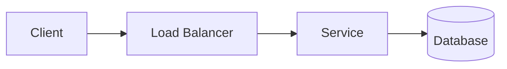

# <System name>

## Requirements
- Functional:
- Non-functional (scale, latency, availability, consistency):

## Back-of-envelope estimates

## Architecture

## Data model / APIs

## Scaling, caching, bottlenecks

## Failure modes and trade-offs
