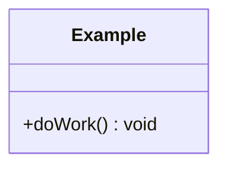

# <Design name>

## Requirements
- Functional:
- Non-functional (thread-safety, performance, extensibility):

## Assumptions / clarifying questions

## Class diagram


## Key design decisions and trade-offs

## Concurrency considerations

## How to run tests
```
cmake -S . -B build && cmake --build build && ctest --test-dir build
```
